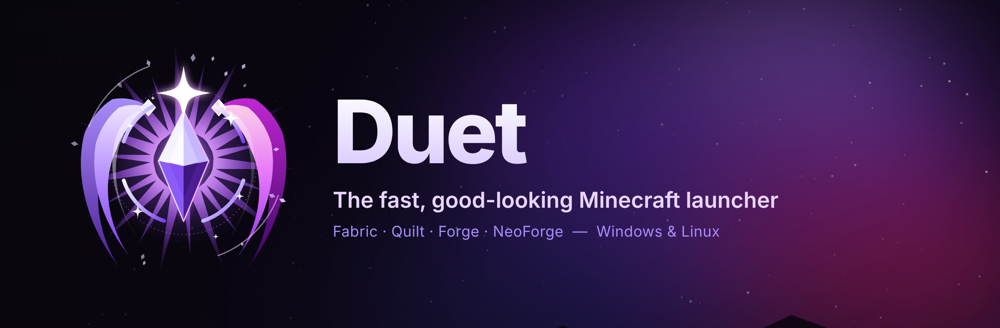
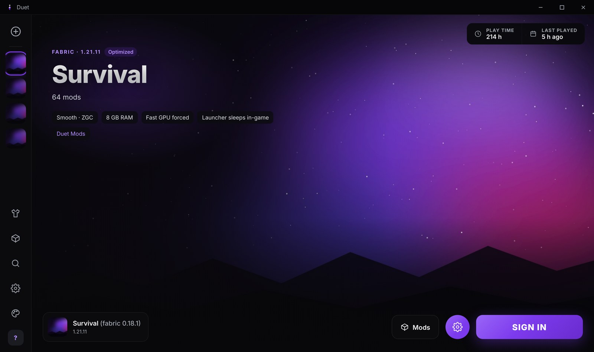
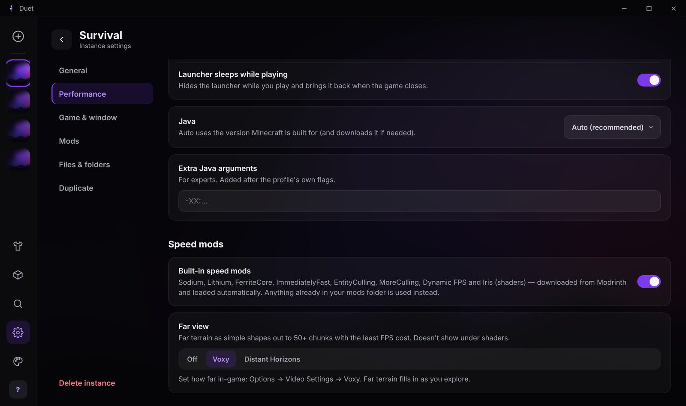
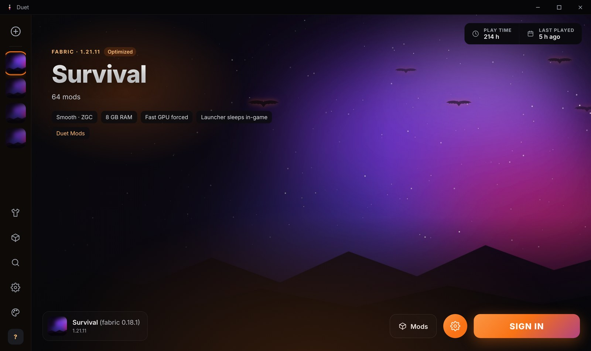
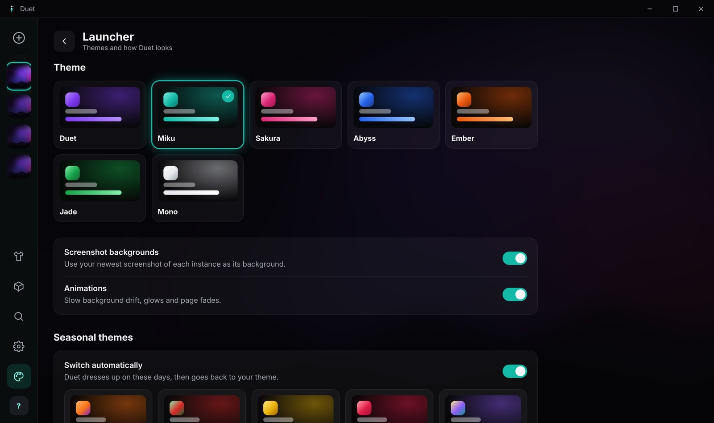

  

  
  
  

  <b>Duet</b> is a Minecraft: Java Edition launcher built for speed and good looks. 
  Instances, mods and modpacks like Modrinth, tuned Java, built-in speed mods and a launcher you'll actually enjoy opening.

  <a href="https://github.com/KadirG47/duet/releases/latest"><b>⬇ Download</b></a> &nbsp;·&nbsp;
  <a href="#features">Features</a> &nbsp;·&nbsp;
  <a href="#faq">FAQ</a>

 

  

## Download

| System | File | Updates |
| --- | --- | --- |
| **Windows 10 / 11** | `Duet_x.y.z_x64-setup.exe` | Automatic |
| **Linux** (any distro) | `Duet_x.y.z_amd64.AppImage` | Automatic |
| **Ubuntu / Debian / Mint** | `Duet_x.y.z_amd64.deb` | Download new versions from the releases page |

Get them from the **[latest release](https://github.com/KadirG47/duet/releases/latest)**. Once installed, Duet updates itself: a button appears when a new version is out, and one click installs it.

## Features

### Play anything
- **Every mod loader**: Fabric, Quilt, Forge and NeoForge, from the newest Minecraft to classics like 1.12.2. Duet installs the loader and the right Java for you.
- **Modpacks in one click**: browse Modrinth's modpacks or drop in an `.mrpack` file. Minecraft, the loader, every mod and its configs are set up automatically.
- **Mods, resource packs and shaders**: search Modrinth, install with dependencies, and update everything with one button.
- **Bring your instances**: imports your Modrinth App profiles without moving any files.

### Built for FPS
- **Tuned Java profiles**: Smooth (generational ZGC for frame times without spikes), Max FPS (tuned G1) or Low RAM.
- **Built-in speed mods**: Sodium, Lithium, FerriteCore, ImmediatelyFast, EntityCulling, MoreCulling, Dynamic FPS and Iris load automatically on Fabric and Quilt. Your mods folder stays untouched.
- **Far view**: 50+ chunk render distance with Voxy or Distant Horizons, one toggle.
- **No FPS cap**: new instances start with uncapped FPS and VSync off. Duet also prefers your fast GPU and sleeps while you play.

  

### Duet Mods
A built-in PvP and HUD mod set for Fabric 1.21.11: hit sounds, reach and combo display, CPS, W-tap trainer, custom crosshair with cooldown ring, shield timer, enemy actions, damage numbers, loot glow, totem pops, kill banners, armor and inventory HUD, and more. It's fair play: no ESP, no macros, and no showing other players' health or items.

### Make it yours
- **Themes**: seven colour themes, plus seasonal ones that switch on by themselves for Halloween, Christmas, New Year, Valentine's, Easter and Miku's birthday.
- **Backgrounds**: your newest screenshot, any image, GIF or looping video, with optional sound or your own music.
- **Skin changer**: a 3D preview, a skin library, copying any player's skin and switching capes.

  
  &nbsp;
  

### Also included
Crash help that explains common crashes in plain words · offline singleplayer for signed-in owners · join a server straight from the launcher · window size and fullscreen options · duplicating instances, with mods linked so they use no extra space · safe deleting to the Recycle Bin · Linux support with fallbacks for WebKitGTK.

## Your account is safe

Signing in uses **Microsoft's own sign-in page**. Duet never sees your password. Your sign-in tokens stay on your own PC and are only sent to Microsoft and Mojang. Duet checks that the account owns Minecraft before the game can start, as Mojang requires.

> **Status:** Microsoft sign-in is waiting for Mojang's approval for third-party launchers. Until then you can set everything up (instances, mods, modpacks, skins); playing unlocks once the approval comes through.

## FAQ

<b>Windows says "Windows protected your PC"</b>

 
Duet isn't code-signed yet, so Windows SmartScreen warns about it. Click <b>More info → Run anyway</b>. Official downloads are only published on this page.

<b>A video background doesn't play on Linux</b>

 
Linux plays videos through GStreamer. Use a <code>.webm</code> video, or install the codecs: <code>sudo apt install gstreamer1.0-libav gstreamer1.0-plugins-good</code> (Ubuntu and Debian) or <code>gst-libav</code> (Arch). The <code>.deb</code> installs them automatically.

<b>Where does Duet keep its files?</b>

 
Windows: <code>%APPDATA%\Duet</code> · Linux: <code>~/.local/share/Duet</code>. Imported Modrinth App profiles stay where they are, and both launchers share them.

<b>Does Duet change my mods folder?</b>

 
No. Duet Mods and the speed mods are loaded straight from the launcher. If you already have one of them in your mods folder, yours is used instead.

## Built with

[Tauri](https://tauri.app) and Rust · React · [Modrinth API](https://docs.modrinth.com) · [FabricMC](https://fabricmc.net), [Quilt](https://quiltmc.org), [Forge](https://minecraftforge.net), [NeoForge](https://neoforged.net) · [Eclipse Temurin](https://adoptium.net) · [skinview3d](https://github.com/bs-community/skinview3d)

Speed mods are downloaded from Modrinth and belong to their authors.

---

   
  © 2026 Hydrate (KadirG47). All rights reserved. 
  NOT AN OFFICIAL MINECRAFT PRODUCT. NOT APPROVED BY OR ASSOCIATED WITH MOJANG OR MICROSOFT.

